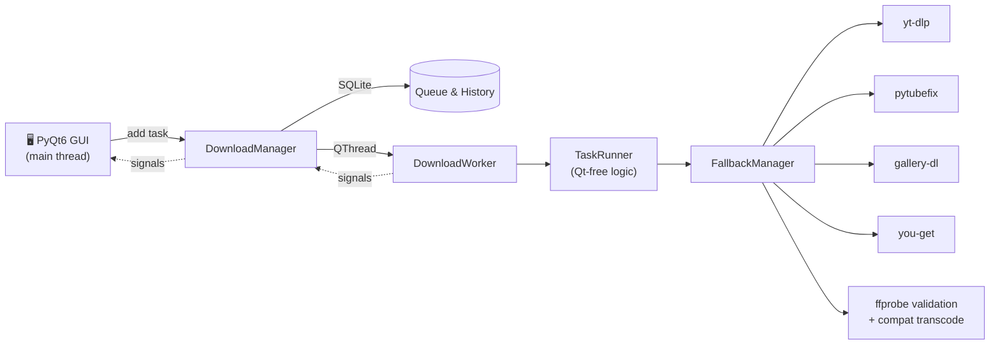
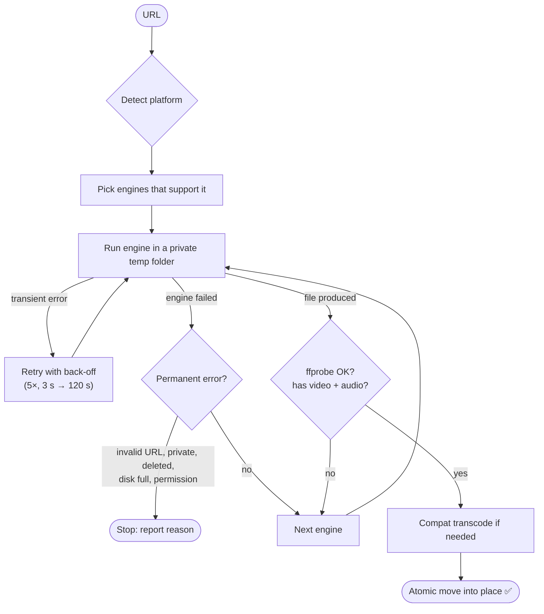

<div align="center">


# Video Downloader

**A fast, resilient desktop downloader for videos, music and whole playlists.**
Four download engines · real pause/resume · smart network recovery · playback-safe output.


[✨ Features](#-features) ·
[🚀 Quick start](#-quick-start) ·
[🧭 Using the app](#-using-the-app) ·
[⚙️ Settings](#%EF%B8%8F-settings-reference) ·
[🧠 How it works](#-how-it-works) ·
[📦 Build &amp; installer](#-build-the-exe-and-the-installer) ·
[🩺 Troubleshooting](#-troubleshooting) ·
[🇸🇦 بالعربية](#-بالعربية)

</div>

---

## ✨ Features

<table>
<tr>
<td width="50%" valign="top">

### ⚡ Fast &amp; smart
- **Auto-analysis** – paste a link and the app analyses it by itself (no button). Change the link and the new one is analysed immediately; stale results are ignored.
- **Instant preview** – title and thumbnail appear first, then duration (badge on the thumbnail), resolutions and estimated size.
- **Download-manager speed** – 1–16 parallel fragments, 10 MB range requests, optional **aria2c**.
- **Result cache** – the last 32 analysed links open instantly.

</td>
<td width="50%" valign="top">

### 🛡️ Reliable
- **Real Pause / Resume / Cancel** – pause keeps the partial file; cancel asks *keep or delete*.
- **Network recovery** – exponential back-off (3 s → 6 s → 12 s … max 120 s), then *Interrupted*, then **auto-resume** when the internet returns.
- **Crash-safe queue** – unfinished tasks come back after a restart.
- **Partial-file protection** – private temp folders, atomic moves, no silent overwrite.

</td>
</tr>
<tr>
<td valign="top">

### 🎬 Playback-safe output
- MP4 prefers **H.264 + AAC**.
- Every file from every engine is verified with **ffprobe**; an audio-only "video" is rejected and the next engine is tried.
- **Compatibility mode** re-encodes only the streams that need it, so files play on TVs, phones, browsers and QQPlayer.

</td>
<td valign="top">

### 📚 Playlists
- Whole playlists into a folder named after them (`001 - Title.mp4`).
- **Checkable list** with thumbnails, duration badges, sizes and live per-item status.
- Click anywhere on a row to select/deselect it. All thumbnails preload in parallel.
- SoundCloud sets get real track names and artwork.

</td>
</tr>
<tr>
<td valign="top">

### 🖥️ Desktop experience
- Sidebar: **Dashboard · Downloader · Queue · Library · History · Diagnostics · Settings**
- Dark / light themes, **English &amp; Arabic (RTL)**
- System tray, notifications, clipboard monitor, drag &amp; drop
- Presets: Best · Balanced · Small · Compatible · Custom
- Speed limit and download **schedule** (windows may cross midnight)

</td>
<td valign="top">

### 🪟 Windows-grade packaging
- **No terminal windows**, ever – child processes run hidden.
- One-folder `VideoDownloader.exe` + a real **Inno Setup installer** (wizard, shortcuts, uninstaller).
- Logs and settings in `%APPDATA%`, never in Program Files.
- In-app **Update download engines** button.

</td>
</tr>
</table>

### Supported sources

| Platform | Engines tried (in order) |
|---|---|
| **YouTube** | yt-dlp → pytubefix |
| **TikTok · Instagram · X/Twitter · Facebook · SoundCloud** | yt-dlp → gallery-dl → you-get |
| **Vimeo** | yt-dlp → you-get |
| **Any other site** | yt-dlp → gallery-dl → you-get |

> Coverage depends on what the underlying libraries support at the time. Sites change often – see [Troubleshooting](#-troubleshooting).
> Private, DRM-protected or login-only content cannot be downloaded without valid cookies (and DRM never).

---

## 🚀 Quick start

### Option A – Windows installer (for users)

1. Run **`VideoDownloader_Setup.exe`** → follow the wizard (default folder `C:\Program Files\Video Downloader`, any folder or drive can be chosen).
2. Tick the **Desktop** / **Start Menu** shortcut options → **Install** → optionally **Launch Video Downloader**.
3. Install **FFmpeg** once (`winget install Gyan.FFmpeg`) for high resolutions, MP3 and validation.

> Closing the installer with ✕ or pressing *Cancel* installs nothing and starts nothing.

### Option B – Run from source

<details open>
<summary><b>🪟 Windows</b></summary>

```bat
:: Python 3.11+ from python.org (tick "Add python.exe to PATH")
cd video_downloader
python -m venv .venv
.venv\Scripts\activate
pip install -r requirements.txt

winget install Gyan.FFmpeg
winget install DenoLand.Deno

python main.py
```
</details>

<details>
<summary><b>🐧 Linux / 🍎 macOS</b></summary>

```bash
cd video_downloader
python3 -m venv .venv && source .venv/bin/activate
pip install -r requirements.txt
sudo apt install ffmpeg            # Fedora: dnf · Arch: pacman · macOS: brew install ffmpeg
curl -fsSL https://deno.land/install.sh | sh      # or: brew install deno
python main.py
```
</details>

### Tools the app can use

| Tool | Status | Why |
|---|---|---|
| **FFmpeg + ffprobe** | ⭐ strongly recommended | Merge video+audio (most YouTube qualities), MP3, bitrate, MKV, validation, compatibility conversion |
| **Deno / Node / Bun** | ⭐ recommended for YouTube | Solves YouTube's JavaScript challenges (the app finds one on `PATH` and hands it to yt-dlp) |
| **aria2c** | optional | Multi-connection transfers (`Settings → Use aria2c`). Off by default – Pause/Cancel react slower with it |

Without FFmpeg the app still works with single-file streams and tells you exactly what is limited.

---

## 🧭 Using the app

### 📥 Downloader
1. **Paste** a link (or drop it on the window / press *Paste URL*). Analysis starts automatically.
2. Choose a **preset**:

   | Preset | Result |
   |---|---|
   | 🏆 Best Quality | Highest available |
   | ⚖️ Balanced | Up to 1080p, H.264 |
   | 📉 Small File Size | Up to 480p |
   | 📺 Compatible | MP4 + H.264 + AAC – plays everywhere |
   | 🎛️ Custom | 144p–8K, container, codec, audio format/bitrate, quality-vs-size priority |

   Resolutions that do not exist for the video are disabled.
3. For **playlists**, tick the items you want (all are selected by default). Each row shows thumbnail, duration, size (when the source states it) and live status: *Downloading / Done / Failed / Skipped*.
4. **Start Download** queues and starts; **Add to Queue** only queues. The progress card has **Pause · Resume · Cancel**.

### 📋 Download Queue
Thumbnail, title, progress, speed, ETA, quality, engine and status for every task – with Pause, Resume, Cancel, Retry, Remove, priority ▲▼, *Clear Completed* and *Start/Pause Queue*.

`Pending → Extracting → Downloading → Completed` · side paths: `Paused`, `Interrupted`, `Failed`, `Cancelled`.

### 🖼️ Media Library
Everything in your download folder as a **grid or list** with FFmpeg-made previews, search, video/audio filter, sorting, *Open*, *Open Folder*, *Rename* (never overwrites) and *Delete* (asks first; only files inside the download folder can be touched).

### 🕘 Download History
SQLite-backed history with search, platform/status filters, *Open File/Folder*, *Retry Failed* and *Remove Record* (the file is kept unless you choose otherwise).

### 🩺 Diagnostics
Plain-language error explanations by category, **Show technical details**, **Copy details**, **Export diagnostic report** (credentials and cookies redacted), the log viewer, a dependency checklist and **Update download engines**.

### ⌨️ Shortcuts

| Keys | Action |
|---|---|
| `Ctrl+1 … 7` | Jump to page |
| `Ctrl+Enter` | Start download |
| `Ctrl+L` | Focus the link box |
| `Ctrl+,` | Settings |
| `Ctrl+J` | Toggle console (hidden by default; opens itself on errors) |

---

## ⚙️ Settings reference

<details>
<summary><b>Click to expand the full table</b></summary>

| Setting | Default | Meaning |
|---|---|---|
| Download folder | `~/Downloads/VideoDownloader` | Where files are saved |
| Default quality / format / audio bitrate | Best / MP4 / 192 | Pre-selected on the Downloader page |
| Quality preset | Best | Best, Balanced, Small, Compatible, Custom |
| Preferred codec | Auto | Auto, H.264, VP9, AV1 (ignored for MP4 while Compatibility mode is on) |
| Compatibility mode | On | MP4 + H.264 + AAC; re-encodes only what needs it |
| Save thumbnail beside the download | Off | Writes `<title>.jpg` (never overwrites) |
| Embed thumbnail in MP3 | On | Cover art inside MP3 files |
| Download connections | 8 | Parallel fragments / range requests (1–16) |
| Use aria2c | Off | Multi-connection transfers if aria2c is installed |
| Speed limit | Unlimited | KB/s per download |
| If a file already exists | Keep both | Keep both (adds a number), skip, or overwrite |
| Filename templates | `{title}` / `{index} - {title}` | Fields `{title} {id} {uploader} {date}` (+ `{index} {playlist}`) |
| FFmpeg path | empty | Empty = use `PATH` / next to the exe |
| Cookies | none | Browser cookies or a `cookies.txt` file |
| Maximum retries | 5 | Network retries before a task becomes *Interrupted* |
| Initial retry delay | 3 s | Doubles after each failed attempt (max 120 s) |
| Concurrent downloads | 1 | Tasks downloaded at the same time |
| Start queued downloads automatically | On | No need to press *Start Queue* |
| Resume automatically when the network is back | On | Interrupted tasks continue by themselves |
| Keep partial downloads | On | Required for Pause/Resume and recovery |
| Resume unfinished downloads after a restart | Off | Recovered tasks start without asking |
| Download schedule | Off | Run the queue only between two times |
| Language / Theme | English / Dark | English or Arabic (RTL, restart needed); dark or light |
| Clipboard monitor | Off | Put a copied link into the Downloader |
| System tray · close/minimise to tray | On · Off · Off | Keep running in the tray |
| Notifications | On | Tray balloon on completion/failure |
| Check for updates · release address | Off · empty | Needs an https GitHub-releases style address |
| Log verbosity | Info | *Debug* adds technical details |

</details>

**Where data lives**

| Mode | Settings, history, logs |
|---|---|
| Installed / packaged exe | `%APPDATA%\Video Downloader\` (`config\`, `database\`, `logs\`, `cache\`) |
| Run from source | the project folder |

---

## 🧠 How it works

### Architecture



Workers never touch widgets – they emit signals that the manager (GUI thread) turns into queue and UI updates, so the interface stays responsive during downloads, analysis and conversion.

### Fallback chain



### 🎞️ Why a video could play "audio only" – and the fix
The old sort order ranked AV1 > VP9 > H.264 while the default container was MP4, so players such as QQPlayer received AV1/VP9 video (plus Opus) inside `.mp4`, decoded the sound and showed a black picture. Now MP4 prefers H.264 + AAC, **every output is inspected with ffprobe**, and Compatibility mode converts anything that is not H.264/AAC. If an engine yields an audio-only "video" the result is rejected and the next engine runs; if all do, the task fails with the reason instead of claiming success.

### ⏯️ Pause &amp; resume
Pause raises a stop request honoured at the engine's next progress callback. The partial file stays in `<download folder>/.vdl_tmp/<task id>` with a small state file (URL + quality signature). Resume reuses that folder and yt-dlp continues (`continuedl`); a partial written for a different URL/quality, or an empty one, is discarded. Resume continues from the previous position wherever the server supports HTTP range requests (YouTube does). Old partial folders (7+ days) are cleaned.

### 🌐 Network recovery
Timeouts, DNS failures, resets and temporary file locks (`WinError 32`) are retried with `delay = initial × 2^(attempt−1)` (capped at 120 s). When retries run out the task becomes **Interrupted**, partial data is kept and a lightweight probe checks the network every 15 s; when it succeeds the task resumes by itself. Finished files and finished playlist items are never downloaded again.

### 🧩 Self-healing engines
Errors like `Unexpected response from webpage request` mean a site changed. The app classifies them separately, **keeps trying the other engines**, explains what happened, and offers **Diagnostics → Dependencies → Update download engines**. For non-YouTube sites yt-dlp requests pages like a real browser when `curl-cffi` is installed.

### 🔇 Startup speed &amp; silent processes
- `utils/no_console.py` patches `subprocess.Popen` once at start-up so **every** child process (FFmpeg, ffprobe, gallery-dl, you-get, pip, and helpers yt-dlp starts itself) gets `CREATE_NO_WINDOW` and a hidden `STARTUPINFO`.
- The FFmpeg version probe is cached by path+size+date, leftover-folder cleanup runs 0.4 s *after* the window shows, and download libraries are imported only when needed.
- Uncaught exceptions (including in worker threads) and start-up failures go to `application.log` – no console needed.

---

## 📦 Build the EXE and the installer

> Windows builds must run **on Windows**. The two outputs are separate programs:
>
> | File | Role |
> |---|---|
> | `dist\VideoDownloader\VideoDownloader.exe` | The application. Opens the main window directly – never an installer. |
> | `installer\VideoDownloader_Setup.exe` | The Inno Setup wizard that installs the application folder. |

### 🖱️ One click

| Script | Use it when |
|---|---|
| **`make_exe.bat`** | Normal build. Creates a venv, installs requirements, builds the app, builds the installer, makes a portable zip. If the project path contains non-English characters it automatically builds from `C:\vd`. |
| **`build_clean.bat`** | Copies the project to `C:\vd\video_downloader` and builds there, saving everything to `C:\vd\build_log.txt`. |
| `build_windows.bat` | App only (PyInstaller one-folder). |
| `tools\build_installer.bat` | Installer only (needs the app built first; installs Inno Setup via winget if missing; fails loudly if no real installer is produced). |

> 💡 Keep the project in a plain ASCII path such as `C:\vd\video_downloader`. Arabic letters or brackets in a folder name make pip print `UnicodeEncodeError` and can break builds.

Optional: put `ffmpeg.exe` and `ffprobe.exe` in `tools\bin\` before building to ship them next to the exe (mind FFmpeg's licence).

### 🧾 Installer behaviour (Inno Setup)

| Step | Details |
|---|---|
| Welcome | Standard wizard (English + Arabic) |
| Folder | Default `C:\Program Files\Video Downloader`, **Browse…** for any folder/drive |
| Privileges | Asks for administrator by default; choose **"Install just for me"** for a per-user install with no admin rights |
| Tasks | ☑ Desktop shortcut · ☑ Start Menu shortcut (+ uninstall entry) |
| Finish | ☐/☑ **Launch Video Downloader** – runs only after a successful install |
| Cancel / ✕ | Installs nothing, creates nothing, launches nothing |
| Uninstall | Listed in *Installed apps*; removes program files and shortcuts, then **asks** (default *No*) whether to delete settings/history/logs. Your downloads are never touched |
| License page | Appears automatically if a `LICENSE.txt` exists in the project root |

### ☁️ No Windows PC? Use GitHub Actions
Push the project to GitHub and run **Actions → Build Windows exe and installer → Run workflow**. On a Windows runner it:
1. runs the test-suite and builds the app with PyInstaller,
2. starts the exe and checks it **opens no console** and writes a log,
3. builds the installer and checks it is a real installer (larger than the app exe),
4. simulates closing the installer window and checks nothing is installed or launched,
5. installs silently to a custom folder, checks both shortcuts, the uninstall entry and launch-from-shortcut,
6. uninstalls and checks that files and shortcuts are gone but `%APPDATA%\Video Downloader` is kept,
7. uploads `VideoDownloader_Setup.exe` and the portable zip as artifacts.

### 🔧 Packaging notes
- One-folder build on purpose: a one-file exe unpacks to `%TEMP%` on **every** launch (slow start, more antivirus scanning).
- **UPX is off** on purpose: slower starts and more antivirus false positives.
- `console=False` → GUI-only exe. When frozen, gallery-dl/you-get run as `VideoDownloader.exe --vdl-run-module <module>` (handled in `main.py`).
- Build size is ~150–300 MB (Qt + four download libraries). Warnings such as `urllib3.contrib.emscripten` or `pycparser.lextab` are harmless.
- Windows shows a stale icon after rebuilds? Rename the exe or run `ie4uinit.exe -show`.
- The icon lives in `assets\icons\app.ico` (regenerate with `python tools\make_icon.py`); it is used for the exe, window, taskbar and installer.

---

## 🩺 Troubleshooting

| Problem | What to do |
|---|---|
| `Unexpected response from webpage request` (TikTok…) | Site changed → **Diagnostics → Dependencies → Update download engines**, restart. In the exe build, rebuild with `make_exe.bat` |
| Downloads suddenly fail on one site | `pip install -U yt-dlp pytubefix gallery-dl you-get` |
| `No supported JavaScript runtime could be found` | Install Deno (`winget install DenoLand.Deno`) and restart |
| "Requested format is not available" | Install FFmpeg + a JS runtime; update `yt-dlp[default]` |
| "Sign in to confirm you're not a bot" / age-restricted | Configure cookies in Settings |
| Only low resolutions / no MP3 | Install FFmpeg or set its path |
| Video plays audio only | Keep *Compatibility mode* on; inspect with `ffprobe file.mp4` |
| `WinError 32` while resuming | Antivirus/indexer briefly locking the file – retried automatically |
| Slow downloads | Raise *Download connections*, install aria2c, make sure a JS runtime is found |
| Playlist shows fewer items than expected | Private/deleted items are listed as "(unavailable)" and skipped |
| Build prints `UnicodeEncodeError` / `Logging error` | Project path contains non-English characters → build from `C:\vd` (`build_clean.bat`) |
| A window flashes or the app won't start | Open `%APPDATA%\Video Downloader\logs\application.log` (or *Diagnostics → Application log*) |

---

## 🧪 Tests &amp; honest status

```bash
pip install pytest
python -m pytest -q tests        # 162 passing, 1 skipped
```

The suite covers quality/format selection, ffprobe validation and compatibility conversion (with real media generated by ffmpeg), file safety, queue/history persistence, settings, cookies, the fallback chain, retries/back-off, pause/resume/cancel/interruption with mock engines (via a small Qt stub, so it runs without PyQt6), playlist selection, thumbnails, error classification, the silent-process patch and the installer/build scripts' structure.

| ✅ Verified by automated tests | ⚠️ Must be verified by hand on Windows |
|---|---|
| Logic of engines, queue, recovery, validation, settings | The visual GUI and every button |
| Console-suppression flags, log writing, error classification | Real downloads from real sites, real yt-dlp resume |
| Structure of the `.spec`, `.iss` and build scripts | The PyInstaller exe and the installer wizard (✕/Cancel, custom drive, shortcuts, uninstall) |

The GitHub Actions workflow automates most of the right-hand column on a real Windows runner.

---

## 🗂️ Project structure

```text
main.py                   entry point (no-console patch → logging → window; embedded gallery-dl/you-get when frozen)
app_info.py               name + version (single source of truth, also read by the installer)
gui/                      main_window (sidebar shell), sidebar, dashboard_page, library_page, diagnostics_page,
                          queue_widget, history_widget, settings_dialog, widgets, thumbnails, tray, i18n, styles
core/                     download_manager · download_worker · task_runner · fallback_manager · quality_manager
                          ffmpeg_manager · download_queue · download_history · thumbnail_tools · media_library
                          scheduler · diagnostics · engine_updater · updater · cookie_manager · platform_detector
engines/                  base_engine · ytdlp_engine · pytubefix_engine · gallery_dl_engine · youget_engine
utils/                    file_manager · validators · logger · network · system_info · no_console
config/settings.py        validated JSON settings
assets/icons/             app.ico · app.png          tools/make_icon.py regenerates them
VideoDownloader.spec      PyInstaller spec (one-folder, windowed, icon)
installer/VideoDownloader.iss     Inno Setup script          tools/build_installer.bat
make_exe.bat · build_clean.bat · build_windows.bat · build_onefile_windows.bat
.github/workflows/build-windows.yml   cloud build + install tests
tests/                    pytest suite
```

---

## ⚖️ Legal

Download only content you have the right to download and respect each site's terms of service and copyright law. This project is a front end for open-source libraries and does not circumvent DRM.
